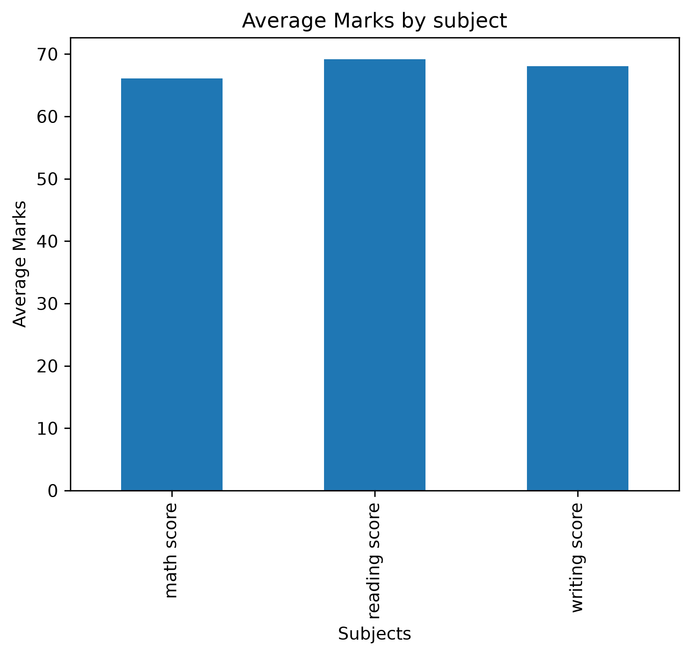
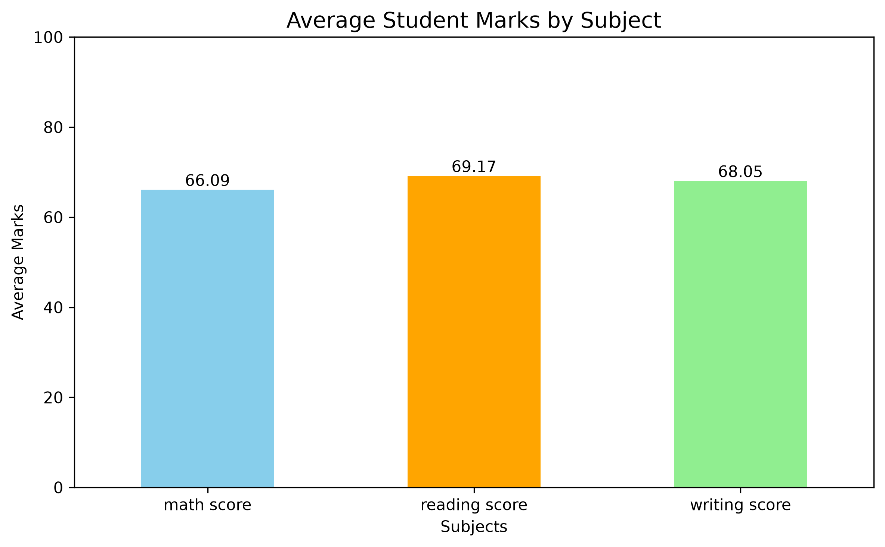

# Student Performance Analysis

## Project Overview
This project analyzes student performance in Math,
Reading, and Writing using Python.

## Dataset
Students Performance Dataset containing 1000 students
and 8 columns.

## Tools Used
- Python
- Pandas
- Matplotlib
- Jupyter Notebook

## Analysis
- Data inspection and cleaning
- Missing values and duplicate checks
- Average marks analysis
- Gender-wise performance comparison
- Test preparation course analysis
- Data visualization

## Key Findings
Average Math Score: 66.09
- Average Reading Score: 69.17
- Average Writing Score: 68.05
- Highest Average Subject: Reading
- Male students have a higher Math average.
- Female students have higher Reading and Writing averages.
- Students who completed test preparation have higher average scores.
- 
## Visualizations
### Average Student Marks by Subject

### Test Preparation Course Analysis

## Author
Data Science Portfolio Project
## Dataset Source
Dataset: Students Performance in Exams

Source: Kaggle
https://www.kaggle.com/datasets/spscientist/students-performance-in-exams
